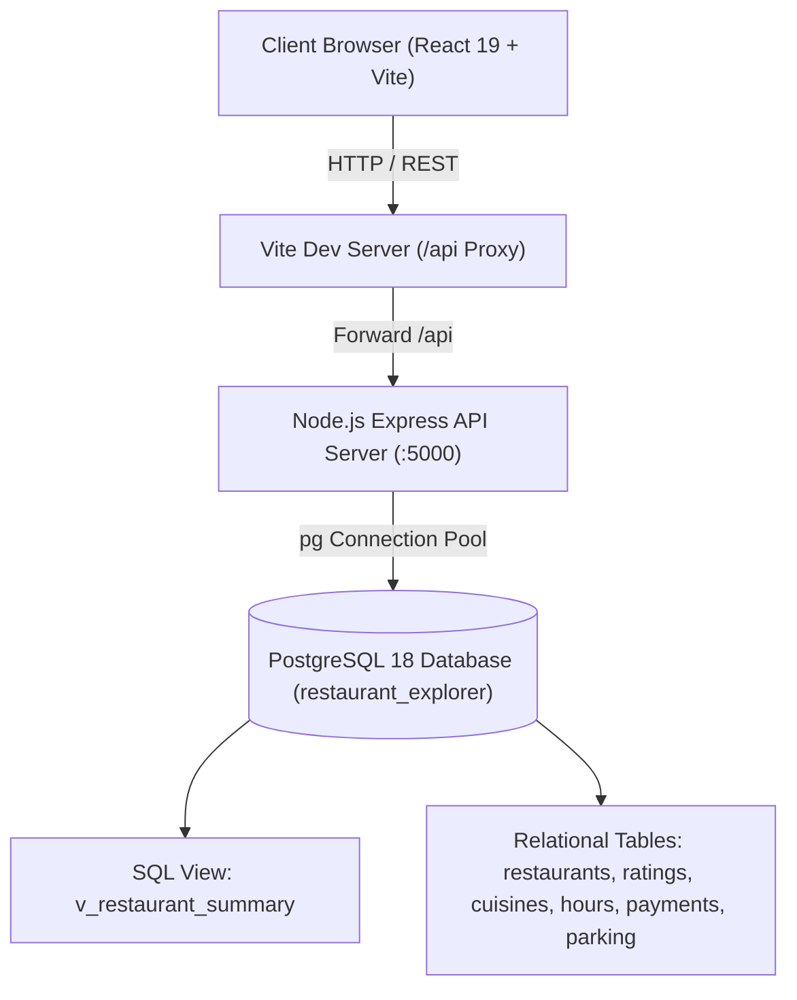

# 🍽️ Restaurant Rating Explorer

[](https://react.dev/)
[](https://vitejs.dev/)
[](https://nodejs.org/)
[](https://expressjs.com/)
[](https://www.postgresql.org/)
[](#)

A high-performance, full-stack restaurant discovery and rating analytics platform engineered with **React 19**, **Vite**, **Express**, and **PostgreSQL 18**. 

Built upon the genuine CENIDET restaurant research dataset, the platform maintains complete data integrity across 130 establishments, 1,161 community ratings, and 23 distinct culinary traditions without synthetic inflation or mocked metrics.

---

## 📑 Table of Contents

- [Architectural Overview](#-architectural-overview)
- [Design Aesthetics & UI System](#-design-aesthetics--ui-system)
- [Key Features](#-key-features)
- [Project Structure](#-project-structure)
- [Getting Started](#-getting-started)
  - [Prerequisites](#prerequisites)
  - [1. Database Configuration (PostgreSQL 18)](#1-database-configuration-postgresql-18)
  - [2. Backend API Setup](#2-backend-api-setup)
  - [3. Frontend Application Setup](#3-frontend-application-setup)
- [REST API Reference](#-rest-api-reference)
- [Database Schema & Integrity](#-database-schema--integrity)
- [Interactive Testing Guide](#-interactive-testing-guide)
- [Privacy & Security Boundary](#-privacy--security-boundary)

---

## 🏛️ Architectural Overview



- **Frontend**: Single-page application built on React 19 and Vite with zero external CSS component bloat. Uses native Vanilla CSS tokens, CSS Grid, Flexbox, and Lucide React icons.
- **Backend API**: Stateless RESTful services powered by Express with parameterized SQL queries, connection pooling (`pg`), and CORS protection.
- **Database**: Normalized relational database in PostgreSQL 18 with multi-column indexes, foreign key constraints, and aggregated reporting views.

---

## 🎨 Design Aesthetics & UI System

The user interface follows a curated editorial design system inspired by contemporary culinary journals:
- **Palette**: Warm Ivory (`#FAF8F4`) background, Deep Forest Green (`#244C3A`) brand accents, Terracotta (`#C85A32`) interactive highlights, and Charcoal (`#20231F`) typography.
- **Typography**: Google Fonts pairing featuring **Playfair Display** for editorial serif headlines and **Inter** for crisp, highly readable interface data.
- **Visual Feedback**: Micro-animations, responsive hover elevations, rating badges on the authentic 0–2 CENIDET scale, and pure CSS distribution bar charts.

---

## ✨ Key Features

### 1. Editorial Hero & Live Search
- **Instant Live Search**: Search across restaurant names, surveyed cities, cuisines, and price tiers in real time.
- **Keyboard Shortcut**: Press `/` from anywhere on the page to focus the search bar.
- **Platform Metrics**: Live counters directly calculated from PostgreSQL (130 restaurants, 1,161 ratings, 23 cuisines).
- **Featured Establishment Showcase**: Highlights top-scoring establishments dynamically.

### 2. Multi-Faceted Filters & Sorting
- **Canonical City Filter**: Standardized geographic detection covering all 130 tables:
  - **San Luis Potosí**: 84 tables
  - **Cuernavaca**: 23 tables
  - **Ciudad Victoria**: 23 tables
- **Price Tiering**: Low (`$`), Medium (`$$`), and High (`$$$`).
- **Rating Tiering**: High (1.50 – 2.00), Moderate (1.00 – 1.49), and Low (< 1.00).
- **Active Filter Chips**: Clickable filter badges with single-click removal (`×`) and a master *"Reset all filters"* action.
- **Sorting Modes**: Alphabetical (A–Z / Z–A), Highest Average Rating, Lowest Average Rating, and Most Reviewed.

### 3. Culinary Traditions Explorer
- Visual cuisine cards representing 23 distinct food traditions (Mexican, Bar, Italian, Seafood, Cafeteria, etc.).
- Clicking any card applies the cuisine filter and smoothly auto-scrolls down to the catalog grid.

### 4. Interactive Restaurant Profile Modal
- **Rating Score Breakdown**: Switch between **Overall**, **Food**, and **Service** tabs to view CSS bar charts showing exact vote distributions across 0 (Low), 1 (Medium), and 2 (High).
- **Operating Schedules**: Day-by-day opening and closing times.
- **Amenities & Services**: Accepted payment methods (Cash, VISA, Mastercard, etc.), parking access, alcohol policy, dress code, smoking area, and website links.
- **Accessibility**: Full ESC key support, outside click dismiss, and backdrop blur.

### 5. Smooth Pagination
- Incremental batch loading ("Show More Tables") with automatic pagination reset when search terms or filter criteria change.

---

## 📁 Project Structure

```
restaurant-rating-explorer/
├── backend/                         # Node.js & Express API Server
│   ├── .env.example                 # Environment configuration template
│   ├── db.js                        # PostgreSQL connection pool configuration
│   ├── package.json                 # Backend dependencies & dev scripts
│   ├── restaurants.js               # REST API route handlers (/api/restaurants)
│   ├── server.js                    # Express app initialization & middleware
│   └── test-db.js                   # Database connectivity verification script
├── data/
│   └── raw/                         # Original CENIDET CSV files
│       ├── chefmozaccepts.csv       # Accepted payment methods
│       ├── chefmozcuisine.csv       # Cuisines mapping (all 916 rows preserved)
│       ├── chefmozhours4.csv        # Operating hours & schedules
│       ├── chefmozparking.csv       # Parking facilities
│       ├── geoplaces2.csv           # Core restaurant geospatial & profile data
│       └── rating_final.csv         # User ratings (1,161 entries)
├── database/                        # PostgreSQL Database Scripts
│   ├── schema.sql                   # DDL table definitions, indexes & views
│   ├── import_data.sql              # Clean CSV import commands (handling '?' as NULL)
│   └── queries.sql                  # Verification & analytical queries
├── frontend/                        # React 19 + Vite Web Application
│   ├── public/                      # Static icons & brand assets
│   ├── src/
│   │   ├── assets/                  # Hero artwork & imagery
│   │   ├── components/              # Modular UI Components
│   │   │   ├── CuisineSection.jsx   # Culinary category showcase
│   │   │   ├── FilterBar.jsx        # Search bar, dropdowns & active filter pills
│   │   │   ├── Footer.jsx           # Editorial footer
│   │   │   ├── Hero.jsx             # Editorial hero with quick search
│   │   │   ├── Navbar.jsx           # Sticky navigation header
│   │   │   ├── RatingDistribution.jsx # CSS bar chart rating breakdown
│   │   │   ├── RestaurantCard.jsx   # Restaurant grid cards
│   │   │   ├── RestaurantDetails.jsx# Detailed profile modal dialog
│   │   │   ├── RestaurantGrid.jsx   # Responsive grid layout with empty states
│   │   │   └── TopRated.jsx         # Top rated restaurant carousel/grid
│   │   ├── services/
│   │   │   └── api.js               # Resilient API client with fallback handling
│   │   ├── utils/
│   │   │   ├── cityHelper.js        # Canonical city coordinate detection
│   │   │   └── imageHelper.js       # Curated restaurant & cuisine photography
│   │   ├── App.jsx                  # Main orchestration component
│   │   ├── index.css                # Design system tokens & utility classes
│   │   └── main.jsx                 # React root render
│   ├── package.json                 # Frontend dependencies (React 19, Lucide)
│   └── vite.config.js               # Vite config with /api reverse proxy
└── README.md                        # Project documentation
```

---

## 🚀 Getting Started

### Prerequisites

Ensure you have the following installed on your machine:
- **Node.js** (v18.0.0 or later) & `npm`
- **PostgreSQL** (v14 or higher; PostgreSQL 18 supported)
- **Git**

---

### 1. Database Configuration (PostgreSQL 18)

1. Open **pgAdmin** or your `psql` command-line terminal:
   ```bash
   psql -U postgres
   ```
2. Create the target database:
   ```sql
   CREATE DATABASE restaurant_explorer;
   ```
3. Connect to the database and execute the schema definition:
   ```bash
   psql -U postgres -d restaurant_explorer -f restaurant-rating-explorer/database/schema.sql
   ```
4. Import the dataset from the CSV files:
   ```bash
   psql -U postgres -d restaurant_explorer -f restaurant-rating-explorer/database/import_data.sql
   ```
5. *(Optional)* Verify database integrity:
   ```bash
   psql -U postgres -d restaurant_explorer -f restaurant-rating-explorer/database/queries.sql
   ```

---

### 2. Backend API Setup

1. Navigate to the backend directory:
   ```bash
   cd restaurant-rating-explorer/backend
   ```
2. Install dependencies:
   ```bash
   npm install
   ```
3. Configure your environment variables:
   Copy `.env.example` to `.env` and verify your PostgreSQL credentials:
   ```ini
   PORT=5000
   DB_HOST=localhost
   DB_PORT=5432
   DB_NAME=restaurant_explorer
   DB_USER=postgres
   DB_PASSWORD=your_password
   ```
4. Test the database connection:
   ```bash
   node test-db.js
   ```
5. Start the backend server in development mode:
   ```bash
   npm run dev
   ```
   *The server will start at `http://localhost:5000`.*

---

### 3. Frontend Application Setup

1. Open a new terminal and navigate to the frontend directory:
   ```bash
   cd restaurant-rating-explorer/frontend
   ```
2. Install dependencies:
   ```bash
   npm install
   ```
3. Start the Vite development server:
   ```bash
   npm run dev
   ```
4. Open your browser and navigate to:
   ```
   http://localhost:5173
   ```
   *(or `http://localhost:5174` if port 5173 is occupied)*.

---

## 📡 REST API Reference

| Method | Endpoint | Description |
| :--- | :--- | :--- |
| `GET` | `/api/health` | Health-check endpoint verifying backend status |
| `GET` | `/api/restaurants` | Returns all 130 restaurants with rating summaries and cuisines |
| `GET` | `/api/restaurants/:placeId` | Detailed profile with operating hours, payments, parking, and score breakdown |
| `GET` | `/api/cuisines` | List of 23 unique cuisines with associated restaurant counts |
| `GET` | `/api/stats` | Aggregated metrics (total restaurants, ratings, cities, cuisines) |

### Sample Response (`GET /api/restaurants/135069`)

```json
{
  "success": true,
  "data": {
    "place_id": 135069,
    "name": "Abondance Restaurante Bar",
    "city": "San Luis Potosi",
    "state": "SLP",
    "price": "low",
    "alcohol": "Wine-Beer",
    "smoking_area": "none",
    "dress_code": "informal",
    "total_reviews": 14,
    "avg_overall_rating": "0.50000000000000000000",
    "cuisines": ["Bar"],
    "operating_hours": [
      { "days": "Mon;Tue;Wed;Thu;Fri;", "hours": "00:00-23:30;" }
    ],
    "payments": ["cash"],
    "parking": ["none"],
    "rating_distribution": {
      "overall": { "0": 8, "1": 5, "2": 1 },
      "food": { "0": 7, "1": 6, "2": 1 },
      "service": { "0": 5, "1": 8, "2": 1 }
    }
  }
}
```

---

## 🗄️ Database Schema & Integrity

1. **Unmatched Cuisines Preserved**: All 916 cuisine records in `chefmozcuisine.csv` are preserved without synthetic restaurant creation (804 unmatched rows retained with foreign keys detached or set to NULLable).
2. **Missing Value Sanitization**: Question mark strings (`?`) in raw CSV files are converted to SQL `NULL` values during import.
3. **Summary View**: `v_restaurant_summary` computes `avg_overall_rating`, `avg_food_rating`, `avg_service_rating`, and `total_reviews` through SQL aggregation.
4. **Rating Scale**: Adheres strictly to the genuine CENIDET scale ($0 = \text{Low}, 1 = \text{Medium}, 2 = \text{High}$).

---

## 🧪 Interactive Testing Guide

| Step | Action | Expected Behavior |
| :--- | :--- | :--- |
| **1. City Filter** | Select **San Luis Potosi** or **Cuernavaca** | The grid filters to 84 (SLP) or 23 (Cuernavaca) restaurants respectively. |
| **2. Price Filter** | Select **Low ($)** or **High ($$$)** | Displays only restaurants matching the selected price tier. |
| **3. Rating Tier** | Select **High (1.50 – 2.00)** | Displays the 25 top-rated restaurants across the platform. |
| **4. Live Search** | Type `"Kiku"` or `"Mexican"` in the search bar | Instantly filters the grid and displays active search badge. |
| **5. Active Chips** | Click the `×` on any active filter badge | Clears that specific filter while maintaining all other active criteria. |
| **6. Reset All** | Click **"Reset all filters"** | Restores all 130 establishments to the view. |
| **7. Cuisine Tile** | Click any cuisine card (e.g. **Mexican**) | Automatically filters to that cuisine and scrolls down to the grid. |
| **8. Profile Modal** | Click any restaurant card | Opens the modal displaying day-by-day hours, payments, parking, and CSS score charts. |
| **9. Modal Dismiss**| Press `ESC` or click `✕` | Closes the modal and returns to the catalog. |
| **10. Pagination** | Click **"Show More Tables"** | Loads the next batch of 12 tables seamlessly. |

---

## 🛡️ Privacy & Security Boundary

In strict compliance with privacy standards, **consumer demographic files** (`userprofile.csv`, `userpayment.csv`, `usercuisine.csv`) containing consumer personality profiles, marital status, birth years, and personal payment preferences are **completely isolated** from the database schema and public application layer. The application strictly queries and displays public establishment records and aggregate community feedback.

---

## 📄 License

This project is licensed under the [MIT License](LICENSE).
